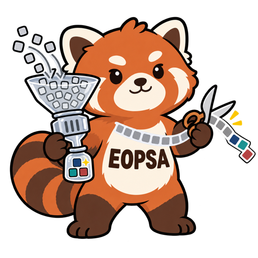

**Efficient On-Policy Self-Distilled Safety Alignment**

  <strong>Qirui Liu</strong>1,*, <strong>Yichen Sun</strong>1,*, Yan Wang2, Yu Mi1, 
  Wei Cao1, Yue Shen2, Zhixuan Chu1,†, Kui Ren1 
  1 Zhejiang University &nbsp;&nbsp; 2 Ant Group 
  <small>* Equal contribution &nbsp;&nbsp; † Corresponding author: <a href="mailto:zhixuanchu@zju.edu.cn">zhixuanchu@zju.edu.cn</a></small>

  
  
  
  

完整说明见 [English README](README.md)。

EOPSA 把 rollout 与梯度预算集中在**监督可靠**且**安全关键**的 token 上：Adaptive Rollout Scheduling 按 Teacher Rescue Rate 截断不可救后缀，Selective Distillation 只更新 `Pivot / Intent / Risk`。相对全序列 OPSD，rollout 计算约减半，反向传播约 2% 的 token。
